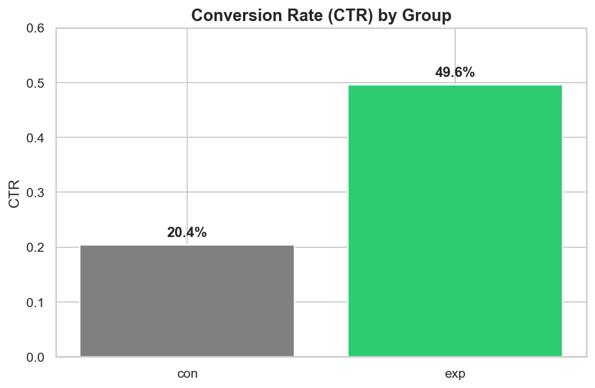
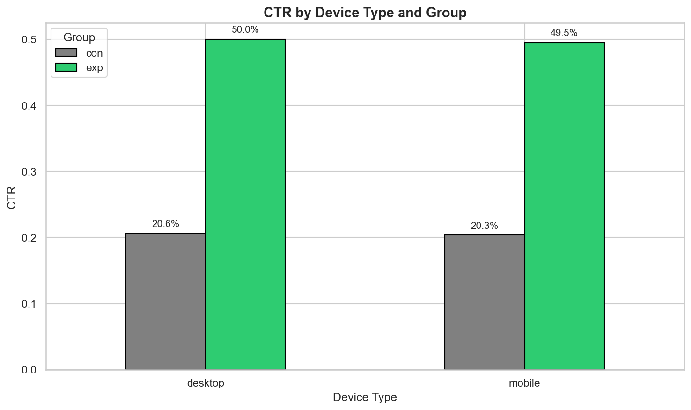

# A/B тестирование. Влияние нововведения на CTR

## Контекст: В компании протестировали новую кнопку. Задача – проверить, принесла ли она рост конверсии. 

## Методология: очистка данных => метрики => Z-тест => сегментация

## Результат:

*Рис. 1. Сравнение CTR контрольной и тестовой групп*

*Рис. 2. CTR в разрезе типов устройств*
пп
## Вывод: CTR вырос с 20.4 до 49.6% (p<0.001). Прирост стабилен вне зависимости от типа устройства клиента. Нововведения нужно пустить в прод

